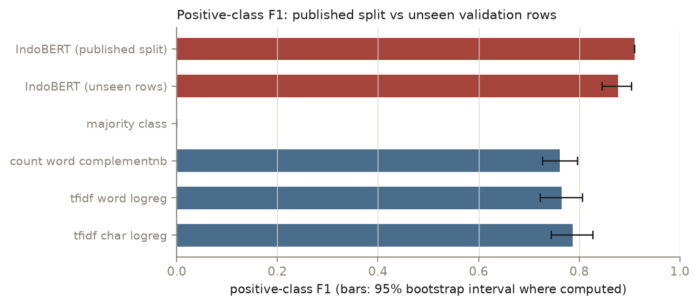
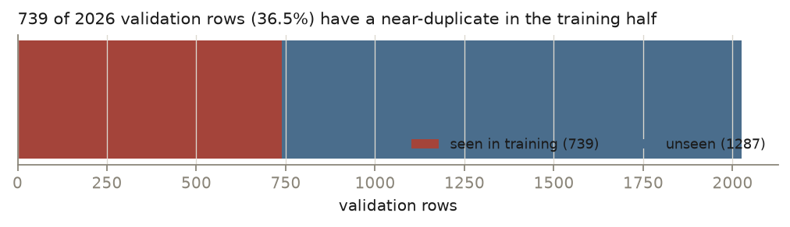

# Indonesian suicide-ideation classification — thesis model, transformer follow-up, and a leakage audit

[](https://github.com/apricitea/text-suicide-ideation-detection/actions/workflows/eval.yml)
[](LICENSE)
[](https://github.com/apricitea/text-suicide-ideation-detection/releases/tag/model-v1)
[](https://github.com/apricitea/text-suicide-ideation-detection/actions/workflows/demo-image.yml)
[](paper/main.pdf)

An Indonesian-language text classifier for suicide-ideation content, built first as an
undergraduate thesis (FastText embeddings + LSTM) and later extended with a fine-tuned IndoBERT on
the same split. This repository now also contains a **re-evaluation of both results**, because the
original comparison turned out to be inflated by duplicate rows.

Research and educational work. **Not a clinical or diagnostic tool** — model outputs must not be
substituted for professional mental-health assessment.

---

## The finding

The corpus is a scraped X sample. Of 10,128 posts, 2,161 are exact duplicates, and the 80/20 split
was drawn at random without deduplicating first. The consequence:

**739 of the 2,026 validation posts (36.5%) also appear, near-verbatim, in the training half.**

Scored only on the 1,287 genuinely unseen validation posts:

| Model | Reported on the published split | Re-evaluated on unseen rows (95% CI) |
|---|---|---|
| Fine-tuned IndoBERT | F1 **0.910** / acc 0.965 | F1 **0.877** [0.845, 0.904] / acc 0.950 |
| TF-IDF char 3–5-grams + logistic regression | — | F1 0.787 [0.744, 0.827] / acc 0.923 |
| TF-IDF word 1–2-grams + logistic regression | — | F1 0.766 [0.722, 0.807] / acc 0.915 |
| Count n-grams + ComplementNB | — | F1 0.762 [0.727, 0.796] / acc 0.895 |
| FastText + LSTM (thesis) | F1 0.79 / acc 0.91 | **not reproducible — see limitation 2** |

- The transformer is still the better model: **+0.090 F1** over the strongest cheap baseline,
  95% CI [+0.049, +0.131], McNemar p = 6.3 × 10⁻⁴. The published gap overstated it.
- Its probabilities are close to honest in aggregate: mean predicted 0.206 against an observed
  positive rate of 0.201, ECE 0.046, Brier 0.046. That makes an operating point meaningful.
- **Operating point (what deployment actually costs):** to catch 90% of ideation-positive posts
  you must review **21.8% of the corpus at 83.6% precision**. At 80% recall: 17.6% reviewed,
  92.0% precision.

Full write-up: [`paper/main.pdf`](paper/main.pdf) · generated report and run manifest:
[`eval/out/`](eval/out) · evaluation code: [`eval/`](eval).





---

## Reproducing it

The evaluation has its own dependency set — no TensorFlow, no torch:

```bash
uv sync --project eval
uv run --project eval python -m si_eval.run          # full run, 2,000 bootstrap resamples
uv run --project eval pytest eval/tests -q           # metric and split tests
```

A run writes `results.json`, `manifest.json` (corpus SHA-256, git revision, package versions), five
figures and a generated `REPORT.md` under `eval/out/<run-id>/`. The committed run is
`20261025-full`. `--quick` skips the bootstrap intervals and finishes in seconds; CI runs that
path on every push.

To retrain the transformer (needs the `transformer` dependency group):

```bash
poetry install --with transformer
cd main && poetry run python indobert_finetune.py
```

That script saves the weights, the tokenizer and per-row validation predictions. The original
thesis run did not, which is why the FastText + LSTM arm cannot be recomputed here.

---

## What is in the repository

| Path | Contents |
|---|---|
| `eval/` | The re-evaluation: leakage measurement, four classical baselines, bootstrap intervals, McNemar tests, calibration, selective prediction, error buckets, tests, CI |
| `paper/` | LaTeX write-up of the audit and its results (6 pages, compiled PDF committed) |
| `main/` | Original pipeline: tweet crawling, stemming/stopword comparison (Sastrawi, Hunspell, Stanza), LSTM notebook, IndoBERT fine-tuning script, workbook pseudonymiser |
| `dataset/` | The final labelled dataset used for the reported models |
| `release/` | Pseudonymised 10k JSONL release + manifest (built by `main/build_public_release.py`) |
| `demo/` | FastAPI service + Dockerfile serving the audited weights; CI builds the image and checks a real prediction against the committed one |
| `indobert_publish/` | Committed IndoBERT metrics and per-row validation predictions; weights are the `model-v1` release asset |
| `hf/` | Dataset and model cards, upload script |
| `hunspell-id-main/` | Indonesian Hunspell dictionary used in the stemming comparison |

The fine-tuned weights are **not** on HuggingFace: the previously advertised
`apricitea/indobert-suicide-ideation` repository does not exist (the URL returns 401), so that
claim has been removed from this README, the profile and the CV. They are published as a GitHub
release asset instead — [`model-v1`](https://github.com/apricitea/text-suicide-ideation-detection/releases/tag/model-v1),
461,903,383 bytes, SHA-256 `fe65a0ea18a5f67569f347c4a84de070d9f8ca49cdacca1b8f66ac6c11cbff76`.
`demo/` serves them and verifies that checksum at build time; `hf/publish.py` will upload to the
Hub instead if you supply a token.

The old Streamlit Space at `apricitea/suicide-detection` is a 2023 LSTM app. It serves models
trained on the leaky split and it currently fails to schedule
(`RUNTIME_ERROR: not enough hardware capacity`), so it is no longer linked as the demo.

Pre-trained Indonesian FastText vectors are **not** included: download `cc.id.300.bin` from
[fastText's crawl vectors](https://fasttext.cc/docs/en/crawl-vectors.html) if you want to re-run
the LSTM notebook.

Python floor is `>=3.10`. `cyhunspell` (used only in the Hunspell arm of the stemming comparison)
has no wheels past Python 3.9, so it lives in its own optional `hunspell` group — install it
separately under a 3.9 interpreter if you need that comparison.

---

## Limitations

1. **IndoBERT was not retrained on a deduplicated split.** Its weights saw the leaked twins, so
   the 0.877 estimate is, if anything, optimistic. A fully clean protocol requires retraining.
2. **The FastText + LSTM thesis arm cannot be re-run.** Its FastText vectors are not in the
   repository and the Keras tokenizer was never saved with the model, so no per-row predictions
   exist. The 0.79 figure is quoted from the thesis, not recomputed. That is a reproducibility
   defect in the original work, recorded rather than hidden.
3. **One split, one seed.** Repeated splits would widen the intervals and could reorder the two
   strongest baselines.
4. **Labels are single-annotator.** No inter-annotator agreement study exists, so the label
   ceiling — and therefore how much a 0.09 F1 difference means — is unknown.
5. **The leakage rate is corpus-specific.** The method transfers to other scraped corpora; the
   36.5% does not.

---

## Data provenance

`dataset/final_dataset.xlsx` is a corpus of Indonesian-language posts collected from X (Twitter)
through the public API and labelled for suicide-ideation content. The file is committed because
Twitter's free developer API no longer permits historical queries, so the training data cannot be
re-fetched for reproducibility.

The post text is third-party user-generated content. It is **not our work**, we assert no licence
over it, and it is included here for research reproducibility only. The labels, preprocessing
pipeline and models in this repository are our own work, released under the MIT licence in
`LICENSE`.

### Identifiers in the corpus were pseudonymised

The corpus originally carried live account names. Measured across all six sheets of the workbook:
27,559 `@handle` occurrences covering 7,602 distinct accounts; in the `10k` training sheet alone,
4,318 of 10,128 rows contained a handle and **296 of those rows carried the positive (ideation)
label.** An account name next to a mental-health label is identifiable personal data, so before
publishing the workbook every handle was replaced with a stable pseudonym
(`@user_` + 8 hex characters of `sha256(salt ‖ handle)`), and `twitter.com/<user>/status/<id>` URLs
were rewritten to their id-only form.

Text and labels are otherwise unchanged, so this file is still the corpus the reported metrics were
computed from, apart from the handle substitution. The salt and the handle → pseudonym map are kept
out of the repository (`private/`, gitignored), so the mapping is reversible for us and not for a
reader.

Reproduce or verify it with:

```bash
python main/pseudonymise_workbook.py --check    # measure handles, write nothing
python main/pseudonymise_workbook.py --write    # apply the transform
```

The transform verifies its own output and refuses to write if any handle survives.

Two things were deliberately left alone:

- **Emoji mojibake.** The workbook mis-decoded UTF-8 as cp1252, so emoji are stored as sequences
  like `😔`. 1,450 rows in the `10k` sheet are affected. A repair exists in
  `main/build_public_release.py --repair-mojibake` but is off by default, so this file matches the
  metrics reported above.
- **Three corporate email addresses** appearing inside post text (`info@careerbridge.coach`,
  `help@dana.id`). These are business support addresses, not personal accounts, and the handle
  transform does not touch text preceded by a word character.

---

## Citation

```bibtex
@misc{nataputra2026leakage,
  title  = {What a 0.91 F1 Actually Measures: Duplicate Leakage in a Scraped Indonesian Mental-Health Corpus},
  author = {Nataputra, Alvin C.},
  year   = {2026},
  note   = {Research note, \url{https://github.com/apricitea/text-suicide-ideation-detection}}
}
```
